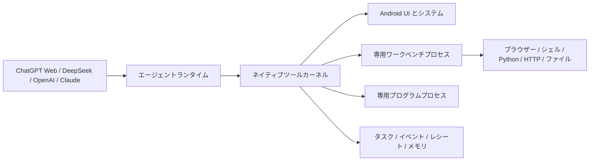

<div align="center">

# OPhone AI

**AI が Android スマートフォンの状態を理解し、操作し、作業結果を検証できるようにするオープンソースのエージェントランタイムです。**

[](docs/COMPATIBILITY.md)
[](app/src/main/java)
[](LICENSE)
[](https://github.com/SilverCoastR/OPhone-AI/releases)

[English](README.md) · [简体中文](README.zh-CN.md) · [한국어](README.ko-KR.md) · **日本語**

</div>

## OPhone AI とは

OPhone AI は、対応する AI プロバイダーを、ユーザーが権限を管理できるスマートフォンエージェントとして利用するためのランタイムです。モデルは Android の UI 状態を確認し、アプリを操作し、ウェブを閲覧し、スクリプトやファイルを扱い、ネットワークへアクセスして、タスクが本当に成功したかを検証できます。

ランタイムは、永続的なタスクとイベントフィードバックを中心に設計されています。チェックポイント、実行レシート、UI の変化、結果イベント、診断情報を記録するため、ユーザーがすべての問題を先に見つけなくても、エージェント自身が失敗を検出して復旧を試みられます。OPhone AI は標準 Android API を使用し、Xiaomi など特定メーカーの専用フレームワークを必要としません。

## 主な特長

- **複数の AI プロバイダー** — ChatGPT Web、DeepSeek API、OpenAI API および互換エンドポイント、Claude API に対応します。
- **永続的で検証可能なタスク** — タスク状態、チェックポイント、成功条件、イベント待機、キャンセル、実行レシート、結果検証を保存します。
- **イベント駆動の Android 自動化** — Accessibility の UI ツリーと操作は、アプリの切り替え、追加・削除されたテキスト、Toast、`no_visible_change` などの構造化された効果を返します。
- **ユーザーによる引き継ぎ** — オプションの操作マスクがエージェントの作業中の誤操作を防ぎます。ユーザーはいつでも操作を引き継ぎ、その後タスクをエージェントへ戻せます。
- **内蔵エージェントワークベンチ** — 専用ブラウザー、シェル、組み込み CPython、HTTP クライアント、ファイル用ワークスペース、ダウンロード、再利用可能な JavaScript プログラムを備えています。
- **メモリと Mini Apps** — ユーザーが確認・削除できる長期メモリと、権限を宣言する単一 HTML ファイルのツールを反復作業に利用できます。
- **安全性を重視した設計** — 機能別スイッチ、アプリ別の制御ポリシー、ローカル監査記録、リスク機能のゲート、Android のシステム確認、暗号化された API 認証情報を使用します。

## 仕組み



注入型またはネイティブのモデルクライアントは、共通のローカルツールプロトコルを使用します。`LocalToolKernel` はすべての呼び出しをタスクの範囲に結び付け、機能とアプリのポリシーを適用し、監査情報を記録してから構造化された結果を返します。ブラウザー、シェル、Python、HTTP、ファイル、録画は別の専用プロセスで実行されます。保存した JavaScript ツールは、JSON 入出力とウォッチドッグを備えた別の隔離プロセスで実行され、Android ブリッジやネットワークへ直接アクセスできません。

## モデルプロバイダー

| プロバイダー | 連携方法 | 会話の扱い |
| --- | --- | --- |
| ChatGPT Web | ログイン済みの内蔵ウェブセッションと注入型 OPhone AI ランタイム | 履歴は ChatGPT のウェブセッションに保持され、API 会話とは分離されます。 |
| DeepSeek | OpenAI 互換の Chat Completions API | 端末内に保存され、ストリーミングとローカルツールに対応します。 |
| OpenAI | OpenAI API またはユーザーが設定した互換 HTTPS エンドポイント | 端末内に保存され、ストリーミングとツール呼び出しに対応します。 |
| Claude | Anthropic Messages API | 端末内に保存され、`tool_use`、`tool_result`、画像のツール結果に対応します。 |

API プロバイダーごとに設定は分離され、API キーは Android Keystore で暗号化されます。プロバイダーを切り替えた後も、ローカルの API 会話を読むことができます。会話コンテキストを別のプロバイダーへ送信する際はユーザーの同意が必要で、非公開の推論内容は転送されません。詳しくは[モデルプロバイダー](docs/MODEL_API.md)をご覧ください。

## 機能

| 分野 | エージェントが利用できる機能 |
| --- | --- |
| タスクエンジン | 永続タスク、チェックポイント、イベント購読、成功条件、復旧診断、キャンセル、会話画面への復帰 |
| Android 自動化 | アプリの検索と起動、Accessibility UI の確認と操作、スクリーンショット、構造化された操作効果、UI 変化の待機、許可された Android Intent、システム情報 |
| ブラウザーとネットワーク | マルチタブ WebView、DOM 操作、JavaScript 実行、スクリーンショット、メディア検出、ズームとプロファイル設定、HTTP リクエスト、サイズ制限付きダウンロード |
| シェル、Python、ファイル | `/system/bin/sh`、アプリ専用ワークスペース、ファイル操作、対応する 64 ビット端末向けの標準ライブラリ付き CPython 3.14 |
| プログラムと Mini Apps | 再利用可能な JavaScript コマンドと、権限を宣言しネットワークへ直接アクセスしない単一 HTML ファイルのツール |
| メモリ | 検索可能な設定、事実、アプリ別の手順、失敗記録。ユーザーが内容を確認して削除できます。 |
| メディア | Android MediaProjection による画面録画と、ウェブ上で検出できるメディアストリームの直接録画 |
| 可観測性 | 実行レシート、結果イベント、ランタイム状態、タスクログ、診断情報、アプリ自身の logcat 出力 |

## セキュリティモデル

OPhone AI は、機密性の高い機能に対するユーザーの制御を維持します。

- Accessibility、画面キャプチャ、アプリのインストールなど、保護された操作には Android の権限と確認フローが引き続き適用されます。
- ツールは、全体の機能スイッチ、タスク範囲、アプリ別ポリシー、引数検証、出力制限、ローカル監査記録によって制御されます。
- 内蔵ブラウザーは ChatGPT Web とは別のプロファイルを使用します。通常の閲覧とテストを目的としており、サイトのアクセス制限を回避するためのものではありません。
- Root シェルは初期状態で無効です。ユーザーが明示的に有効化し、端末に動作する `su` がすでに存在する場合のみ利用できます。OPhone AI が端末を Root 化することはありません。
- API キーは Android Keystore を利用して暗号化され、リポジトリにはコミットされません。

脆弱性の報告とセキュリティ上の指針は [SECURITY.md](SECURITY.md) をご覧ください。

## 動作要件

### 端末

- Android 7.0（API 24）以降
- 内蔵ブラウザーと保存済み JavaScript プログラムは Android 9（API 28）以降
- 内蔵 Python は 64 ビットの `arm64-v8a` または `x86_64` 端末が必要です。非対応 ABI でも Python 以外の機能は使用できます。
- 他アプリの UI 自動化には Accessibility 権限が必要
- 画面録画には MediaProjection の同意が必要

### ビルド環境

- Android Gradle Plugin 3.4 と互換性のある JDK
- Android SDK Platform 33 と Build Tools 33.0.2
- Gradle 5.1.1
- Android NDK とホスト側 Python 3.7 以降
- ランタイムテスト用の Node.js 18 以降

最初の Android ビルドでは、python.org 公式の CPython Android パッケージ（約 46 MB）をダウンロードし、SHA-256 を検証して `.python-cache/` に保存します。ネイティブ Python 拡張には Android 対応の wheel が必要です。

## ビルドとテスト

```text
gradle assembleDebug
node --test tests/runtime.test.mjs
```

`PATH` に `python` がない場合は `-PhostPython=<path>` を指定してください。アプリケーション ID は `ai.ophone.bridge` で、デバッグ APK は `app/build/outputs/apk/debug/` に生成されます。

## 初回起動

1. 制御プロバイダーとして ChatGPT Web、DeepSeek、OpenAI、または Claude を選択します。
2. **設定**を開き、タスクに必要な機能だけを有効にします。
3. エージェントが他のアプリを操作する場合は Accessibility 権限を許可します。
4. API プロバイダーを使う場合は、暗号化されたプロバイダー設定にキーとエンドポイントを保存します。
5. 新しい会話を開始し、期待する結果と重要な完了条件を説明します。

## 既知の制約

- エージェントが操作を要求した後でも、Android が画面上でシステム確認を求める場合があります。
- ストリームの直接録画には検出可能なメディア URL とサーバーへのアクセスが必要です。一般的な代替手段は画面録画です。
- ネイティブ Python パッケージには Android 対応の wheel が必要で、すべての ABI で利用できるわけではありません。
- ウェブサイトやアプリは UI や動作を変更する可能性があります。ランタイムはイベント証拠と復旧診断を使用しますが、すべての外部サービスでの操作成功を保証するものではありません。

## ドキュメント

- [ドキュメント一覧](docs/README.md)
- [ソフトウェアアーキテクチャ](docs/SOFTWARE_ARCHITECTURE.md)
- [機能とローカルツール](docs/FUNCTIONS.md)
- [モデルプロバイダー](docs/MODEL_API.md)
- [互換性](docs/COMPATIBILITY.md)
- [テスト](docs/TESTING.md)
- [セキュリティポリシー](SECURITY.md)

Issue と Pull Request を歓迎します。不具合を報告する際は、Android バージョン、端末 ABI、選択したプロバイダー、関連するタスクの証拠、再現手順を記載してください。

## ライセンス

OPhone AI は [Apache License 2.0](LICENSE) の下で提供されます。
