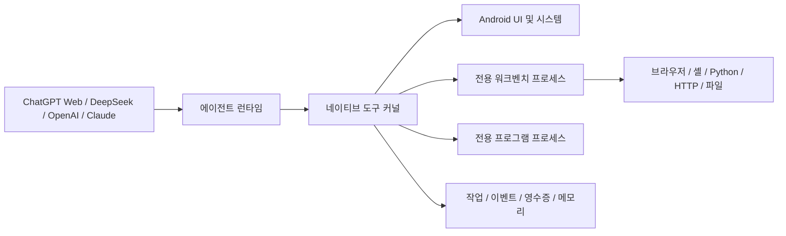

<div align="center">

# OPhone AI

**AI가 Android 휴대폰의 상태를 이해하고, 조작하고, 작업 결과를 검증할 수 있게 하는 오픈 소스 에이전트 런타임입니다.**

[](docs/COMPATIBILITY.md)
[](app/src/main/java)
[](LICENSE)
[](https://github.com/SilverCoastR/OPhone-AI/releases)

[English](README.md) · [简体中文](README.zh-CN.md) · **한국어** · [日本語](README.ja-JP.md)

</div>

## OPhone AI란?

OPhone AI는 지원되는 AI 제공자를 사용자가 권한을 부여한 휴대폰 에이전트로 연결합니다. 모델은 Android UI 상태를 확인하고, 앱을 조작하고, 웹을 탐색하고, 스크립트와 파일을 다루고, 네트워크 요청을 실행한 뒤 작업이 실제로 성공했는지 검증할 수 있습니다.

런타임은 지속 가능한 작업 상태와 이벤트 피드백을 중심으로 설계되었습니다. 체크포인트, 실행 영수증, UI 변화, 결과 이벤트, 진단 증거를 기록하므로 사용자가 모든 문제를 먼저 발견하지 않아도 에이전트가 실패를 감지하고 복구를 시도할 수 있습니다. OPhone AI는 표준 Android API를 사용하며 Xiaomi 등 특정 제조사의 전용 프레임워크를 요구하지 않습니다.

## 주요 특징

- **여러 AI 제공자** — ChatGPT Web, DeepSeek API, OpenAI API 및 호환 엔드포인트, Claude API를 지원합니다.
- **지속 가능하고 검증 가능한 작업** — 작업 상태, 체크포인트, 성공 조건, 이벤트 대기, 취소, 실행 영수증, 결과 검증을 저장합니다.
- **이벤트 기반 Android 자동화** — 접근성 UI 트리와 동작이 앱 전환, 추가되거나 삭제된 텍스트, Toast 메시지, `no_visible_change` 신호 등의 구조화된 효과를 반환합니다.
- **사용자 개입과 인계** — 선택형 제어 마스크가 에이전트 작업 중 실수로 인한 터치를 막습니다. 사용자는 언제든 직접 제어한 뒤 작업을 에이전트에게 다시 넘길 수 있습니다.
- **내장 에이전트 워크벤치** — 전용 브라우저, 셸, 내장 CPython, HTTP 클라이언트, 파일 작업 공간, 다운로드, 재사용 가능한 JavaScript 프로그램을 제공합니다.
- **메모리와 Mini Apps** — 사용자가 확인하고 삭제할 수 있는 장기 메모리와, 권한을 선언하는 단일 HTML 파일 기반 도구를 반복 작업에 사용할 수 있습니다.
- **안전 중심 설계** — 기능별 스위치, 앱별 제어 정책, 로컬 감사 기록, 위험 기능 게이트, Android 시스템 확인, 암호화된 API 자격 증명을 사용합니다.

## 동작 방식



주입형 또는 네이티브 모델 클라이언트는 공통 로컬 도구 프로토콜을 사용합니다. `LocalToolKernel`은 모든 호출을 작업 범위에 연결하고, 기능 및 앱 정책을 적용하고, 감사 증거를 기록한 뒤 구조화된 결과를 반환합니다. 브라우저, 셸, Python, HTTP, 파일, 녹화 작업은 별도의 전용 프로세스에서 실행됩니다. 저장된 JavaScript 도구는 JSON 입출력과 감시 타이머가 있는 또 다른 격리 프로세스에서 실행되며 Android 브리지나 네트워크에 직접 접근할 수 없습니다.

## 모델 제공자

| 제공자 | 연동 방식 | 대화 처리 방식 |
| --- | --- | --- |
| ChatGPT Web | 로그인된 내장 웹 세션과 주입형 OPhone AI 런타임 | 대화 기록은 ChatGPT 웹 세션에 유지되며 API 대화와 분리됩니다. |
| DeepSeek | OpenAI 호환 Chat Completions API | 기기에 로컬 저장되며 스트리밍과 로컬 도구를 지원합니다. |
| OpenAI | OpenAI API 또는 사용자가 설정한 호환 HTTPS 엔드포인트 | 기기에 로컬 저장되며 스트리밍과 도구 호출을 지원합니다. |
| Claude | Anthropic Messages API | 기기에 로컬 저장되며 `tool_use`, `tool_result`, 이미지 도구 결과를 지원합니다. |

각 API 제공자는 독립된 설정과 Android Keystore로 암호화된 API 키를 사용합니다. 제공자를 바꾼 뒤에도 로컬 API 대화를 읽을 수 있습니다. 대화 맥락을 다른 제공자에게 보내려면 사용자 동의가 필요하며 비공개 추론 내용은 전달하지 않습니다. 자세한 내용은 [모델 제공자 문서](docs/MODEL_API.md)를 참조하세요.

## 기능

| 영역 | 에이전트가 사용할 수 있는 기능 |
| --- | --- |
| 작업 엔진 | 지속 작업, 체크포인트, 이벤트 구독, 성공 조건, 복구 진단, 작업 취소, 대화 화면 복귀 |
| Android 자동화 | 앱 검색 및 실행, 접근성 UI 확인과 조작, 스크린샷, 구조화된 동작 효과, UI 변화 대기, 허용된 Android Intent, 시스템 정보 |
| 브라우저와 네트워크 | 다중 탭 WebView, DOM 조작, JavaScript 실행, 스크린샷, 미디어 탐색, 확대/축소 및 프로필 설정, HTTP 요청, 용량이 제한된 다운로드 |
| 셸, Python, 파일 | `/system/bin/sh`, 앱 전용 작업 공간, 파일 작업, 지원되는 64비트 기기에서 표준 라이브러리를 포함한 내장 CPython 3.14 |
| 프로그램과 Mini Apps | 재사용 가능한 JavaScript 명령, 권한을 선언하고 네트워크에 직접 접근하지 않는 단일 HTML 파일 도구 |
| 메모리 | 검색 가능한 사용자 설정, 사실, 앱별 작업 절차, 실패 기록. 사용자가 직접 확인하고 삭제할 수 있습니다. |
| 미디어 | Android MediaProjection 화면 녹화와 웹에서 발견 가능한 미디어 스트림 직접 녹화 |
| 관측 기능 | 실행 영수증, 결과 이벤트, 런타임 상태, 작업 로그, 진단 정보, 앱 자체 logcat 출력 |

## 안전 모델

OPhone AI는 민감한 기능에 대한 사용자의 제어권을 유지합니다.

- 접근성, 화면 캡처, 앱 설치 등 보호된 동작은 Android 권한 및 확인 절차를 그대로 따릅니다.
- 도구는 전역 기능 스위치, 작업 범위, 앱별 정책, 인자 검증, 출력 제한, 로컬 감사 기록으로 제어됩니다.
- 내장 브라우저는 ChatGPT Web과 분리된 프로필을 사용합니다. 해당 제어 기능은 일반적인 탐색과 테스트를 위한 것이며 사이트 접근 제한을 우회하기 위한 것이 아닙니다.
- Root 셸은 기본적으로 꺼져 있습니다. 사용자가 명시적으로 켜고 기기에 정상적인 `su`가 이미 있을 때만 동작하며, OPhone AI가 기기를 루팅하지는 않습니다.
- API 키는 Android Keystore 기반 암호화로 저장되며 저장소에 커밋되지 않습니다.

보안 문제 신고와 지침은 [SECURITY.md](SECURITY.md)를 참조하세요.

## 요구 사항

### 기기

- Android 7.0(API 24) 이상
- 내장 브라우저와 저장된 JavaScript 프로그램은 Android 9(API 28) 이상
- 내장 Python은 64비트 `arm64-v8a` 또는 `x86_64` 기기 필요. 지원되지 않는 ABI에서도 Python 이외의 기능은 사용할 수 있습니다.
- 다른 앱의 UI를 자동화하려면 접근성 권한 필요
- 화면 녹화에는 MediaProjection 동의 필요

### 빌드 환경

- Android Gradle Plugin 3.4와 호환되는 JDK
- Android SDK Platform 33 및 Build Tools 33.0.2
- Gradle 5.1.1
- Android NDK 및 호스트 Python 3.7 이상
- 런타임 테스트용 Node.js 18 이상

첫 Android 빌드는 python.org의 공식 CPython Android 패키지(약 46MB)를 다운로드하고 SHA-256 해시를 확인한 뒤 `.python-cache/`에 저장합니다. 네이티브 Python 확장은 Android 호환 wheel이 필요합니다.

## 빌드 및 테스트

```text
gradle assembleDebug
node --test tests/runtime.test.mjs
```

`PATH`에 `python`이 없다면 `-PhostPython=<path>`를 전달하세요. 애플리케이션 ID는 `ai.ophone.bridge`이며 디버그 APK는 `app/build/outputs/apk/debug/`에 생성됩니다.

## 처음 실행하기

1. 제어 제공자로 ChatGPT Web, DeepSeek, OpenAI 또는 Claude를 선택합니다.
2. **설정**을 열고 작업에 필요한 기능만 활성화합니다.
3. 에이전트가 다른 앱을 조작해야 한다면 접근성 권한을 허용합니다.
4. API 제공자를 사용할 경우 암호화된 제공자 설정에 키와 엔드포인트를 저장합니다.
5. 새 대화를 시작하고 원하는 결과와 중요한 완료 조건을 설명합니다.

## 알려진 제약 사항

- 에이전트가 동작을 요청한 뒤에도 Android가 화면에 시스템 확인을 표시할 수 있습니다.
- 스트림 직접 녹화는 탐색 가능한 미디어 URL과 서버 접근 권한이 필요합니다. 일반적인 대안은 화면 녹화입니다.
- 네이티브 Python 패키지는 Android 호환 wheel이 필요하며 모든 ABI에서 사용할 수 있는 것은 아닙니다.
- 웹사이트와 앱은 UI나 동작을 변경할 수 있습니다. 런타임은 이벤트 증거와 복구 진단을 사용하지만 모든 타사 작업의 성공을 보장할 수는 없습니다.

## 문서

- [문서 색인](docs/README.md)
- [소프트웨어 아키텍처](docs/SOFTWARE_ARCHITECTURE.md)
- [기능 및 로컬 도구](docs/FUNCTIONS.md)
- [모델 제공자](docs/MODEL_API.md)
- [호환성](docs/COMPATIBILITY.md)
- [테스트](docs/TESTING.md)
- [보안 정책](SECURITY.md)

Issue와 Pull Request를 환영합니다. 문제를 보고할 때는 Android 버전, 기기 ABI, 선택한 제공자, 관련 작업 증거, 재현 절차를 포함해 주세요.

## 라이선스

OPhone AI는 [Apache License 2.0](LICENSE)으로 배포됩니다.
