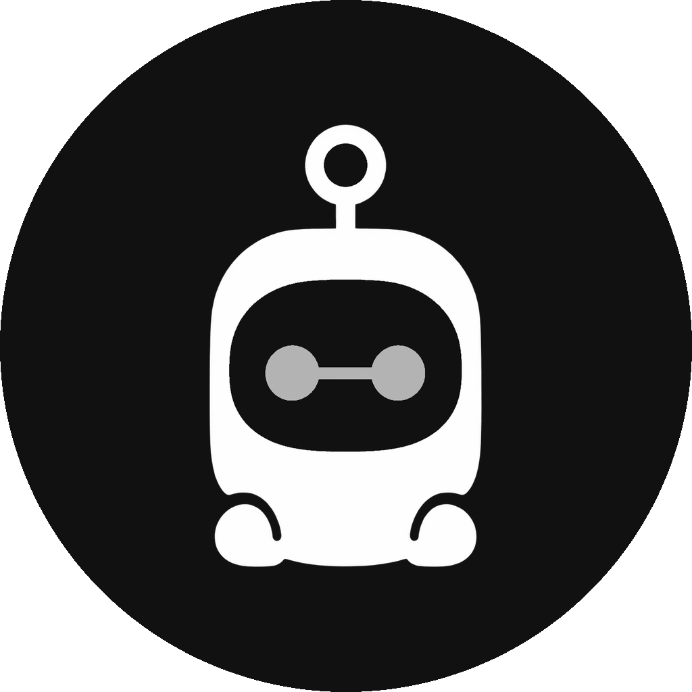
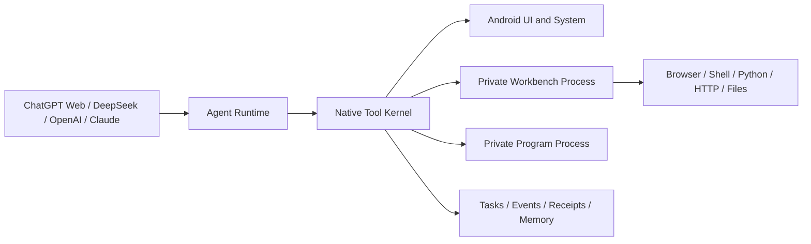

<div align="center">



# OPhone AI

**An open-source Android agent runtime that lets AI understand, operate, and verify work on a phone.**

[](https://github.com/SilverCoastR/OPhone-AI/releases/latest/download/OPhone-AI.apk)

**[⬇ Download Android APK (latest release)](https://github.com/SilverCoastR/OPhone-AI/releases/latest/download/OPhone-AI.apk)**  
<sub>Always the newest release; the app can also update itself from About & updates.</sub>

[](docs/COMPATIBILITY.md)
[](app/src/main/java)
[](LICENSE)
[](https://github.com/SilverCoastR/OPhone-AI/releases)

**English** · [简体中文](README.zh-CN.md) · [한국어](README.ko-KR.md) · [日本語](README.ja-JP.md)

</div>

## What is OPhone AI?

OPhone AI turns a supported AI provider into a permissioned phone agent. The model can inspect Android UI state, operate apps, browse the web, run scripts, work with files, make network requests, and verify whether a task actually succeeded.

The runtime is designed around durable tasks and event feedback. It records checkpoints, execution receipts, UI effects, outcome events, and diagnostic evidence so the agent can detect failures and recover without depending on a person to notice every problem. OPhone AI uses standard Android APIs and does not require a Xiaomi or other vendor-specific framework.

## Highlights

- **Multiple AI providers** — ChatGPT Web, DeepSeek API, OpenAI API and compatible endpoints, and Claude API.
- **Durable, verifiable tasks** — persisted task state, checkpoints, success criteria, event waiting, cancellation, execution receipts, and result verification.
- **Event-driven Android automation** — Accessibility UI trees and actions return structured effects such as package changes, added or removed text, Toast messages, and `no_visible_change` signals.
- **Human takeover** — an optional control mask prevents accidental touches while the agent works; the user can take control and hand the task back at any time.
- **Built-in agent workbench** — private browser, shell, bundled CPython, HTTP client, file workspace, downloads, and reusable JavaScript programs.
- **Memory and Mini Apps** — user-visible long-term memory plus permission-declared, single-file HTML utilities created for recurring workflows.
- **Safety by design** — per-capability switches, per-app control policy, local audit records, risk gates, Android system confirmations, and encrypted API credentials.

## How it works



The injected or native model client talks to a common local-tool protocol. `LocalToolKernel` scopes every call to a task, applies capability and app policies, records audit evidence, and returns structured results. Browser, shell, Python, HTTP, file, and recording work runs in a separate private process. Saved JavaScript utilities run in another isolated process with JSON input/output, a watchdog, and no direct Android bridge or network access.

## Model providers

| Provider | Integration | Conversation behavior |
| --- | --- | --- |
| ChatGPT Web | Embedded authenticated web session plus the injected OPhone AI runtime | Chat history stays with the ChatGPT web session and is separate from API conversations. |
| DeepSeek | OpenAI-compatible chat-completions API | Stored locally; supports streaming and local tools. |
| OpenAI | OpenAI API or a user-configured compatible HTTPS endpoint | Stored locally; supports streaming and tool calls. |
| Claude | Anthropic Messages API | Stored locally; supports `tool_use`, `tool_result`, and image tool results. |

Each API provider has separate settings and an API key protected by Android Keystore encryption. Local API conversations remain readable after switching providers. Sending conversation context to a different provider requires user consent, and private reasoning traces are not forwarded. See [Model providers](docs/MODEL_API.md) for details.

## Capabilities

| Area | What the agent can use |
| --- | --- |
| Task engine | Persistent tasks, checkpoints, event subscriptions, success criteria, recovery diagnostics, cancellation, and return-to-chat behavior |
| Android automation | App discovery and launch, Accessibility UI inspection/actions, screenshots, structured action effects, UI waiting, approved Android intents, and system information |
| Browser and network | Multi-tab WebView, DOM actions, JavaScript evaluation, screenshots, media discovery, zoom and profile controls, HTTP requests, and bounded downloads |
| Shell, Python, and files | `/system/bin/sh`, an app-private workspace, file operations, and bundled CPython 3.14 with the standard library on supported 64-bit devices |
| Programs and Mini Apps | Reusable JavaScript commands plus single-file HTML tools with declared permissions and no direct network access |
| Memory | Searchable preferences, facts, per-app playbooks, and failure notes that the user can inspect and delete |
| Media | Android MediaProjection screen recording and direct recording of discoverable web media streams |
| Observability | Execution receipts, outcome events, runtime health, task logs, diagnostics, and the app's own logcat output |

## Safety model

OPhone AI keeps the user in control of sensitive capabilities:

- Accessibility, screen capture, app installation, and other protected actions remain subject to Android permission and confirmation flows.
- Tools are controlled by global capability switches, task scope, per-app policy, argument validation, output limits, and local audit records.
- The built-in browser uses a profile separate from ChatGPT Web. Its controls are intended for ordinary browsing and testing, not for bypassing site access controls.
- Root shell is off by default. It works only when the user explicitly enables it and the device already provides a functioning `su`; OPhone AI does not root a device.
- API keys are stored with Android Keystore-backed encryption and are never committed to the repository.

Read [SECURITY.md](SECURITY.md) for reporting and security guidance.

## Requirements

### Device

- Android 7.0 (API 24) or newer
- Android 9 (API 28) or newer for the built-in browser and saved JavaScript programs
- A 64-bit `arm64-v8a` or `x86_64` device for bundled Python; the rest of the app can run without Python on unsupported ABIs
- Accessibility permission for cross-app UI automation
- MediaProjection consent for screen recording

### Build machine

- A JDK compatible with Android Gradle Plugin 3.4
- Android SDK Platform 33 and Build Tools 33.0.2
- Gradle 5.1.1
- Android NDK and host Python 3.7+
- Node.js 18+ for runtime tests

The first Android build downloads the official python.org CPython Android package (about 46 MB), verifies its SHA-256 digest, and caches it under `.python-cache/`. Native Python extensions require Android-compatible wheels.

## Build and test

```text
gradle assembleDebug
node --test tests/runtime.test.mjs
```

Pass `-PhostPython=<path>` if `python` is not available on `PATH`. The application ID is `ai.ophone.bridge`; the debug APK is generated in `app/build/outputs/apk/debug/`.

## First run

1. Choose ChatGPT Web, DeepSeek, OpenAI, or Claude as the control provider.
2. Open **Settings** and enable only the capabilities needed for the task.
3. Grant Accessibility access if the agent needs to operate other apps.
4. For an API provider, save its key and endpoint in the encrypted provider settings.
5. Start a conversation and describe the result you want, including any completion criteria that matter.

## Known boundaries

- Android may require visible system confirmation even when the agent has requested an action.
- Direct stream recording depends on a discoverable media URL and server access; screen recording is the general fallback.
- Native Python packages need Android-compatible wheels and are not available on every ABI.
- Websites and apps can change their UI or behavior. The runtime uses event evidence and recovery diagnostics, but it cannot guarantee every third-party workflow.

## Documentation

- [Documentation index](docs/README.md)
- [Software architecture](docs/SOFTWARE_ARCHITECTURE.md)
- [Functions and local tools](docs/FUNCTIONS.md)
- [Model providers](docs/MODEL_API.md)
- [Compatibility](docs/COMPATIBILITY.md)
- [Testing](docs/TESTING.md)
- [Security policy](SECURITY.md)

Issues and pull requests are welcome. Please include the Android version, device ABI, selected provider, relevant task evidence, and reproducible steps when reporting a problem.

## License

OPhone AI is licensed under the [Apache License 2.0](LICENSE).
