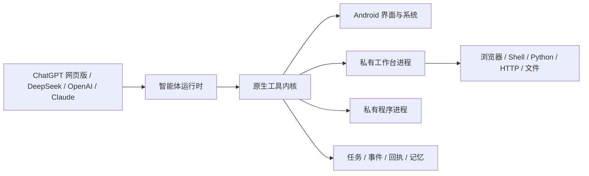

<div align="center">

# OPhone AI

**开源 Android 智能体运行环境，让 AI 能在手机上理解状态、执行操作并验证结果。**

[](docs/COMPATIBILITY.md)
[](app/src/main/java)
[](LICENSE)
[](https://github.com/SilverCoastR/OPhone-AI/releases)

[English](README.md) · **简体中文** · [한국어](README.ko-KR.md) · [日本語](README.ja-JP.md)

</div>

## OPhone AI 是什么？

OPhone AI 可以把受支持的 AI 平台变成一个经过授权的手机智能体。模型能够读取 Android 界面状态、操作应用、浏览网页、运行脚本、处理文件、发起网络请求，并检查任务是否真正完成。

运行时以持久任务和事件反馈为核心。它会记录检查点、执行回执、界面变化、结果事件和诊断证据，让智能体能够主动发现失败并尝试恢复，不再依赖用户逐个发现问题。OPhone AI 只使用标准 Android API，不依赖小米或其他手机厂商的专用框架。

## 核心特点

- **多个 AI 平台** — 支持 ChatGPT 网页版、DeepSeek API、OpenAI API 及兼容接口、Claude API。
- **持久且可验证的任务** — 任务状态、检查点、完成条件、事件等待、终止、执行回执和结果验证都会被记录。
- **事件驱动的 Android 自动化** — 无障碍界面树和操作会返回结构化效果，包括应用切换、文字增减、Toast 信息和 `no_visible_change` 信号。
- **用户随时接管** — 可选的控制遮罩会在智能体工作时阻止误触；用户可以随时接管，并在完成手动操作后交还任务。
- **内置智能体工作台** — 私有浏览器、Shell、内置 CPython、HTTP 客户端、文件工作区、下载和可复用 JavaScript 程序。
- **记忆与 Mini Apps** — 用户可查看和删除的长期记忆，以及为重复流程创建、声明权限的单文件 HTML 小工具。
- **以安全为基础** — 能力开关、逐应用控制策略、本地审计、风险门控、Android 系统确认和加密的 API 凭据。

## 工作原理



注入式或原生模型客户端通过统一的本地工具协议工作。`LocalToolKernel` 会把每次调用绑定到具体任务，执行能力与应用策略，写入审计证据，再返回结构化结果。浏览器、Shell、Python、HTTP、文件和录制任务在单独的私有进程中运行。保存的 JavaScript 程序在另一个隔离进程中执行，使用 JSON 输入输出和超时看门狗，不能直接访问 Android 桥接或网络。

## 模型平台

| 平台 | 接入方式 | 对话处理方式 |
| --- | --- | --- |
| ChatGPT 网页版 | 内嵌的已登录网页会话和注入式 OPhone AI 运行时 | 聊天记录保留在 ChatGPT 网页会话中，与 API 对话分开。 |
| DeepSeek | OpenAI 兼容的 Chat Completions API | 保存在本机，支持流式输出和本地工具。 |
| OpenAI | OpenAI API 或用户配置的兼容 HTTPS 接口 | 保存在本机，支持流式输出和工具调用。 |
| Claude | Anthropic Messages API | 保存在本机，支持 `tool_use`、`tool_result` 和图片工具结果。 |

每个 API 平台都有独立设置，API Key 由 Android Keystore 加密保护。切换平台后仍可读取本地 API 对话；把对话上下文发送给另一个平台前需要用户同意，模型的私有推理内容不会被转发。详细信息见[模型平台文档](docs/MODEL_API.md)。

## 功能范围

| 领域 | 智能体可以使用的能力 |
| --- | --- |
| 任务引擎 | 持久任务、检查点、事件订阅、完成条件、恢复诊断、终止任务和返回对话 |
| Android 自动化 | 查找和启动应用、无障碍界面读取与操作、截图、结构化操作效果、等待界面变化、经过限制的 Android Intent 和系统信息 |
| 浏览器与网络 | 多标签 WebView、DOM 操作、JavaScript 执行、截图、媒体发现、缩放与浏览器配置、HTTP 请求和受限下载 |
| Shell、Python 与文件 | `/system/bin/sh`、应用私有工作区、文件操作，以及在受支持的 64 位设备上运行带标准库的内置 CPython 3.14 |
| 程序与 Mini Apps | 可复用 JavaScript 命令，以及声明权限且不能直接联网的单文件 HTML 工具 |
| 记忆 | 可搜索的偏好、事实、逐应用操作经验和失败记录，用户可以查看和删除 |
| 媒体 | Android MediaProjection 系统录屏，以及直接录制网页中可发现的媒体流 |
| 可观测性 | 执行回执、结果事件、运行状态、任务日志、诊断信息和本应用自身的 logcat 日志 |

## 安全模型

OPhone AI 对敏感能力保留明确的用户控制：

- 无障碍、屏幕录制、应用安装等受保护操作仍须经过 Android 权限和确认流程。
- 工具调用受到全局能力开关、任务范围、逐应用策略、参数校验、输出限制和本地审计的共同约束。
- 内置浏览器使用与 ChatGPT 网页版分开的浏览器配置。它用于正常浏览和测试，不用于绕过网站访问控制。
- Root Shell 默认关闭。只有用户主动开启且设备已经提供可用的 `su` 时才能工作；OPhone AI 不会给设备获取 Root。
- API Key 使用 Android Keystore 支持的加密保存，不会提交到代码仓库。

安全报告和使用建议见 [SECURITY.md](SECURITY.md)。

## 环境要求

### 手机

- Android 7.0（API 24）或更高版本
- 内置浏览器和已保存 JavaScript 程序需要 Android 9（API 28）或更高版本
- 内置 Python 需要 64 位 `arm64-v8a` 或 `x86_64` 设备；不支持的 ABI 仍可使用应用的其他功能
- 跨应用界面自动化需要无障碍权限
- 系统录屏需要 MediaProjection 授权

### 构建环境

- 与 Android Gradle Plugin 3.4 兼容的 JDK
- Android SDK Platform 33 和 Build Tools 33.0.2
- Gradle 5.1.1
- Android NDK 和主机端 Python 3.7+
- 运行时测试需要 Node.js 18+

首次构建 Android 应用时会下载 python.org 官方 CPython Android 包（约 46 MB），校验 SHA-256 后缓存到 `.python-cache/`。原生 Python 扩展需要 Android 兼容的 wheel。

## 构建与测试

```text
gradle assembleDebug
node --test tests/runtime.test.mjs
```

如果 `PATH` 中没有 `python`，可传入 `-PhostPython=<路径>`。应用 ID 为 `ai.ophone.bridge`，调试 APK 生成在 `app/build/outputs/apk/debug/`。

## 初次使用

1. 选择 ChatGPT 网页版、DeepSeek、OpenAI 或 Claude 作为控制平台。
2. 打开**设置**，只启用当前任务需要的能力。
3. 智能体需要操作其他应用时，授予无障碍权限。
4. 使用 API 平台时，在加密的平台设置中保存 Key 和接口地址。
5. 新建对话并说明希望得到的结果，以及重要的完成条件。

## 已知边界

- 即使智能体已经发起操作，Android 仍可能要求用户在系统界面中明确确认。
- 直接录制媒体流需要网页暴露可用的媒体地址且服务器允许访问；系统录屏是通用备用方式。
- 原生 Python 包需要 Android 兼容的 wheel，并非所有 ABI 都能使用。
- 网站和应用可能随时调整界面或行为。运行时会根据事件证据和恢复诊断处理变化，但不能保证所有第三方流程都能完成。

## 文档

- [文档索引](docs/README.md)
- [软件架构](docs/SOFTWARE_ARCHITECTURE.md)
- [功能与本地工具](docs/FUNCTIONS.md)
- [模型平台](docs/MODEL_API.md)
- [兼容性](docs/COMPATIBILITY.md)
- [测试](docs/TESTING.md)
- [安全策略](SECURITY.md)

欢迎提交 Issue 和 Pull Request。报告问题时，请提供 Android 版本、设备 ABI、所选模型平台、相关任务证据和可复现步骤。

## 许可证

OPhone AI 使用 [Apache License 2.0](LICENSE) 许可证。
